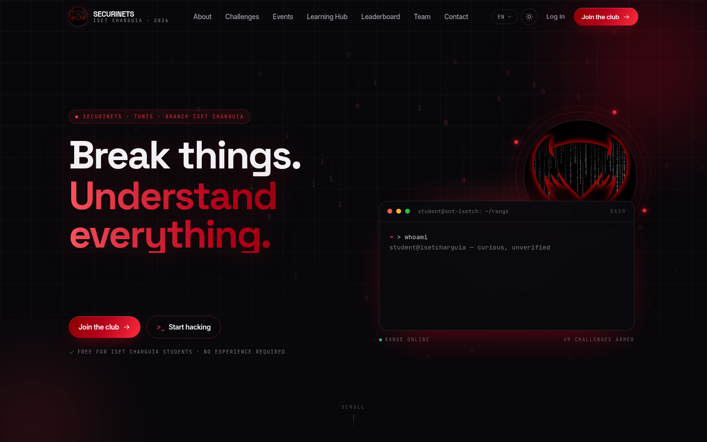

# Securinets ISET Charguia — club website & CTF hub

Production-ready website for **Securinets ISET Charguia**, the student
cybersecurity club of ISET Charguia (Tunis, Tunisia), branch of the Securinets
association. Relaunch year: **2026**.

Red-on-black cyber-security aesthetic, glassmorphism cards, animated binary
rain, terminal typing, scroll motion — plus a working CTF module with accounts,
hashed flags, scoring, hints and a leaderboard.



---

## Stack

| Layer | Choice |
| --- | --- |
| Framework | Next.js 15 (App Router) + React 19 + TypeScript |
| Styling | Tailwind CSS 3.4, CSS variables for theming |
| Motion | Framer Motion 12 + hand-written canvas effects |
| Auth | Auth.js (NextAuth v5) — credentials provider, JWT sessions |
| Database | PostgreSQL / Supabase (optional) with a zero-config JSON fallback |
| Fonts | Space Grotesk (display), Inter (text), JetBrains Mono (code) |
| Icons | Inline SVG set (no icon package) |

---

## Quick start

```bash
npm install
cp .env.example .env.local      # optional for local demo
npm run dev                     # http://localhost:3000
```

No database is required to explore the site. Without `DATABASE_URL` the app
uses a file-backed store at `.data/store.json` (git-ignored), seeded
automatically on first boot with:

- an admin account: `securinetsisetch26@gmail.com` / `ChangeMe!2026`
- 12 demo players and ~300 solves so the leaderboard is not empty

> Change the admin password (or set `ADMIN_EMAIL` / `ADMIN_PASSWORD` in
> `.env.local` **before** the first run) and delete `.data/` to reseed.

Production build:

```bash
npm run build && npm start
```

---

## Environment variables

| Variable | Required | Purpose |
| --- | --- | --- |
| `NEXT_PUBLIC_SITE_URL` | recommended | Canonical URL for metadata, sitemap, OG images |
| `AUTH_SECRET` | production | Auth.js signing secret (`openssl rand -base64 32`) |
| `DATABASE_URL` | production | Postgres/Supabase connection string. Omit for the file store |
| `ADMIN_EMAIL` / `ADMIN_PASSWORD` | first boot | Seeded admin account |
| `NEXT_PUBLIC_CTFD_URL` | optional | Link to a self-hosted CTFd (option B) |

OAuth providers (`AUTH_DISCORD_ID`, `AUTH_GITHUB_ID`, …) are reserved in
`.env.example`; the credentials provider works without them.

---

## Pages

| Route | What it does |
| --- | --- |
| `/` | Hero with terminal animation, live counters, about preview, featured challenges, next event, values, partners, newsletter |
| `/about` | Mission, 2026 relaunch timeline, values, programme, ethics |
| `/team` | Filterable board / tech / HR / comms / events / mentors |
| `/events` | Upcoming + past with galleries and lightbox, season calendar |
| `/challenges` | 49 challenges, filters (category, difficulty, solved, search, sort), progress panel, achievements |
| `/challenges/[slug]` | Brief (Markdown), attachments, paid hints, flag submission, related |
| `/learning` | Six-stage roadmap, curated resources, toolbox, writeups |
| `/leaderboard` | All-time / season, podium + table, live from the database |
| `/join` | Validated membership form with honeypot and rate limit |
| `/contact` | Channels, address, mail form, FAQ accordion |
| `/verify` | Certificate registry lookup (`SNT-ISETCH-2026-001`) |
| `/login`, `/register` | Accounts |
| `/admin` | Protected CMS: challenges, events, members, announcements, applications |

---

## Challenge hub (option A — built in)

- **49 sample challenges** across 10 categories, 22 of them beginner (45%),
  spread over four difficulty tiers with points in the requested bands.
- **Filters**: category chips with counts, difficulty, solved/unsolved, search,
  sort by points / newest / most solved.
- **Progress**: score, solved count, rank, per-category bars, eight badges
  (`First Blood`, `Web Master`, `Crypto Nerd`, `Ghost in the Wires`,
  `Polyglot`, `Certified Insane`, `Hat Trick`, `Century`).
- **Hints** cost points and are unlocked server-side; the hint text is only
  returned after the unlock is recorded.
- **Flag submission**: server-side comparison, instant feedback, confetti,
  wrong-attempt throttling, guest mode (progress in `localStorage`).
- **Scoring**: `sum(solved points) − sum(unlocked hint costs)`, ties broken by
  who solved first.

### Flags are never stored in clear

Seeded challenges keep only `salt` + `flagHash` (SHA-256). Admin-created flags
are hashed with `makeFlagHash()` before the write. The public projection
(`toPublic`) strips `flag`, `flagHash`, `salt` and `hidden`, and the admin page
replaces hashes with the string `"set"` before sending records to the browser.

Verify everything is hashed:

```bash
node scripts/hash-flags.mjs --check
```

### Rate limiting

`lib/rate-limit.ts` is an in-memory sliding window (single process):

| Endpoint | Limit |
| --- | --- |
| Flag submissions | 20/min/IP, 5 min block · 8 wrong attempts per challenge / 10 min |
| Hint unlocks | 30/min/IP |
| Registration | 5/hour/IP |
| Membership form | 5/hour/IP |
| Certificate lookup | 40/min/IP |

For serverless or multi-instance deployments swap the implementation for
Upstash Redis / Vercel KV — the `hit(key, options)` signature stays the same.

### Option B — CTFd

Prefer a battle-tested CTF platform? See **[docs/CTFD-INTEGRATION.md](docs/CTFD-INTEGRATION.md)**
for self-hosting CTFd, linking it from the site and syncing the leaderboard.

---

## Add a challenge (60 seconds)

1. Sign in as admin → `/admin` → **Challenges** → **New challenge**.
2. Title, category, difficulty, points, description (Markdown), hints, flag.
3. Save — it is live immediately on `/challenges`.

Repository workflow, attachments and the JSON schema are documented in
**[docs/ADD_CHALLENGE.md](docs/ADD_CHALLENGE.md)** and
[data/challenges/README.md](data/challenges/README.md).

---

## Admin panel

`/admin` is protected twice: the layout calls `auth()` and redirects
non-admins, and every server action re-checks the session role.

- **Overview** — members, challenges, solves, applications.
- **Challenges** — create/edit/delete, paid hints, featured/hidden, flag reset.
- **Events** — create/edit/delete, capacity, registration open/closed.
- **Members** — team cards with role, team, accent colour, links.
- **Announcements** — shown on the home page notice bar.
- **Applications** — every membership form, with a mailto link.

Edits are stored as overrides (`content` table or `.data/store.json`) and merged
over the JSON seed, so nothing requires a deploy and seeded files stay clean.
Deleting an override-managed record hides it with a tombstone.

See **[docs/ADMIN-GUIDE.md](docs/ADMIN-GUIDE.md)**.

---

## Arcade

`/arcade` ships four self-contained browser games (cipher wheel, phishing inbox,
port reflex, byte rebuild). Scores are stored in `localStorage`; there is no
server write, so nothing to moderate. Embedded via `components/arcade/arcade.tsx`
and linked from the home page ("Playground").

## Project structure

```
app/
  layout.tsx              fonts, metadata, theme script, chrome
  page.tsx                home (server) -> components/sections/home.tsx
  about|team|events|…     marketing routes
  challenges/             hub + [slug] detail (SSG with ISR)
  admin/                  dashboard + server actions
  api/                    auth, progress, submit, hint, leaderboard, join, verify
components/
  layout/                 navbar, footer, page hero, newsletter
  sections/               page-level compositions (client, i18n-aware)
  challenges/             card, explorer, detail, progress panel
  ui/                     icons, motion primitives, badges, brand, headings
  effects/                matrix rain, terminal, confetti
  admin/                  dashboard + editors
lib/
  db.ts                   Postgres or file store, one small API
  challenges.ts           seed+override loader, public projection, flag hashing
  scoring.ts              score, badges, ranking
  i18n/                   en / fr / ar dictionaries + provider
  theme.tsx               dark/light with pre-paint script
  client-store.tsx        session + progress context (guest aware)
data/
  site.ts                 club identity, nav, categories, copy-ready content
  challenges/*.json       49 challenge definitions
  events.json team.json certificates.json
public/
  brand/logo.jpg          the seal
  challenges/<slug>/      downloadable artefacts (all synthetic)
db/schema.sql             Postgres schema for provisioning
docs/                     add-challenge, admin, CTFd, screenshots
scripts/                  brand generator, artefact generators, e2e, hashing
```

---

## Internationalisation

- **EN / FR** complete UI + page copy; **AR** partial with automatic RTL
  (`dir="rtl"`, logical CSS properties). Missing Arabic keys fall back to
  English.
- Locale persists in `localStorage` + a cookie; the `<html lang>` and `dir`
  attributes update on switch.
- Content authored in JSON (challenges, team roles) is English-first; team
  roles ship with a French variant. Add `titleFr`-style fields where needed.

## Accessibility & performance

- Skip link, visible focus rings, semantic landmarks, `aria-expanded` on all
  disclosures, keyboard-operable lightbox/FAQ/menus, labelled form fields,
  `aria-live` feedback on flag submission.
- Reduced-motion support: matrix rain, typing, reveals and confetti all respect
  `prefers-reduced-motion`.
- Contrast tuned for both themes (off-white on #08080b; #151116 on #faf9fb,
  accent text lightened in dark mode for 4.5:1).
- Static/ISR wherever possible (home 2 min, challenges 2 min, team 5 min),
  `next/font` self-hosting, AVIF/WebP images, no icon library, one motion
  dependency.

## Deployment

### Vercel (recommended)

1. Push the repo, import it in Vercel.
2. Create a Supabase project → copy the **pooled** connection string.
3. Add env vars: `DATABASE_URL`, `AUTH_SECRET`, `NEXT_PUBLIC_SITE_URL`,
   `ADMIN_EMAIL`, `ADMIN_PASSWORD`.
4. Run `db/schema.sql` in the Supabase SQL editor (the app also creates tables
   on first request).
5. Deploy. Rotate the admin password after the first login.

### Netlify

Use `@netlify/plugin-nextjs`, same env vars. The file store is not persistent
on serverless — set `DATABASE_URL`.

### Self-hosted

```bash
npm ci && npm run build
DATABASE_URL=… AUTH_SECRET=… npm start   # behind nginx/caddy
```

---

## Scripts

| Command | Description |
| --- | --- |
| `npm run dev` / `build` / `start` | Next.js lifecycle |
| `npm run typecheck` | `tsc --noEmit` |
| `npm run flags:hash` | Hash plaintext flags in `data/challenges/*.json` |
| `node scripts/hash-flags.mjs --check` | CI guard: every challenge has a hash |
| `node scripts/sync-artifact-sizes.mjs` | Validate attachments and sync sizes |
| `node scripts/generate-brand.mjs` | Rebuild favicon, app icons, OG image from the seal |
| `node scripts/samples/gen_assets.py` | Regenerate synthetic challenge artefacts |
| `node scripts/samples/gen_pcap.py` | Regenerate the four packet captures |
| `node scripts/e2e.mjs` | Headless smoke test: login → solve → admin |

---

## Before going live — replace the placeholders

- [ ] Social handles in `data/site.ts` (currently placeholder profile URLs).
- [ ] Contact addresses (`contact@`, `partners@`, `security@`).
- [ ] Team names and bios (avatars are generated portraits in `public/images/team/`).
- [ ] Event dates, galleries and attendance numbers.
- [ ] **All 49 sample flags** — they are demo artefacts, not a real competition.
- [ ] `ADMIN_PASSWORD`, `AUTH_SECRET`, then delete `.data/` if it was used.
- [ ] Certificate records in `data/certificates.json`.
- [ ] Partner logos/names and the 84-member counter on the home page.

## Licence & credits

Code: MIT. The Securinets seal and the name belong to the club. Sample
challenges, artefacts and packet captures were generated for this project and
contains no real data.
